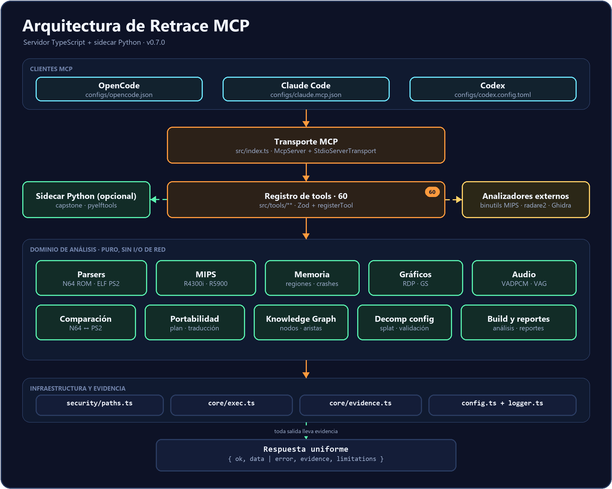
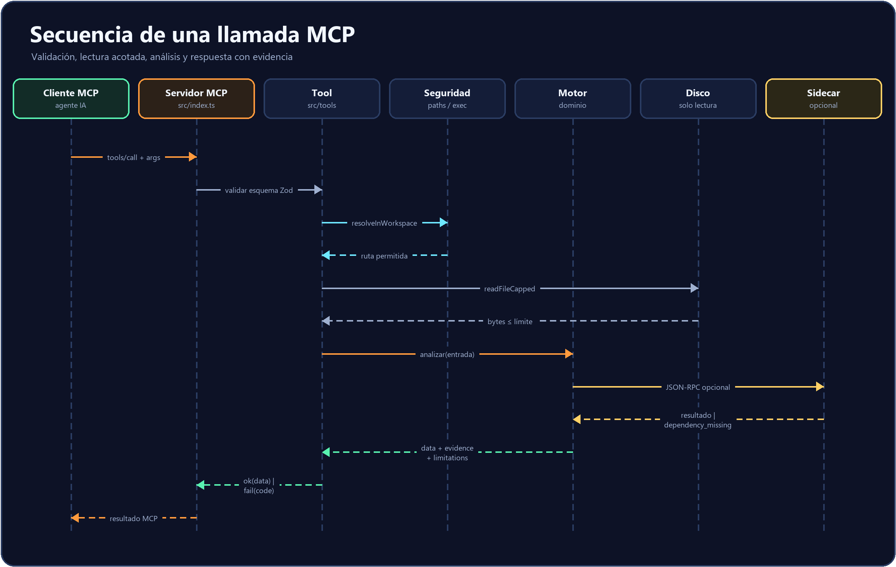
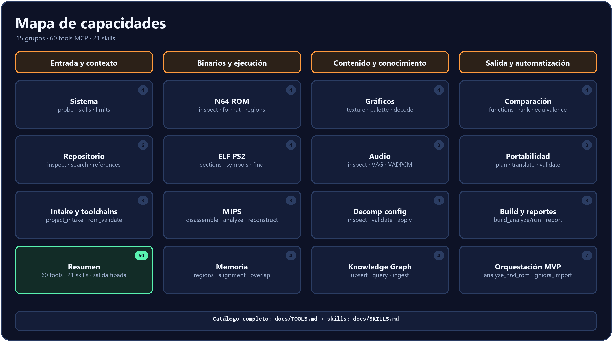
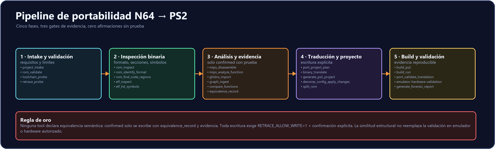
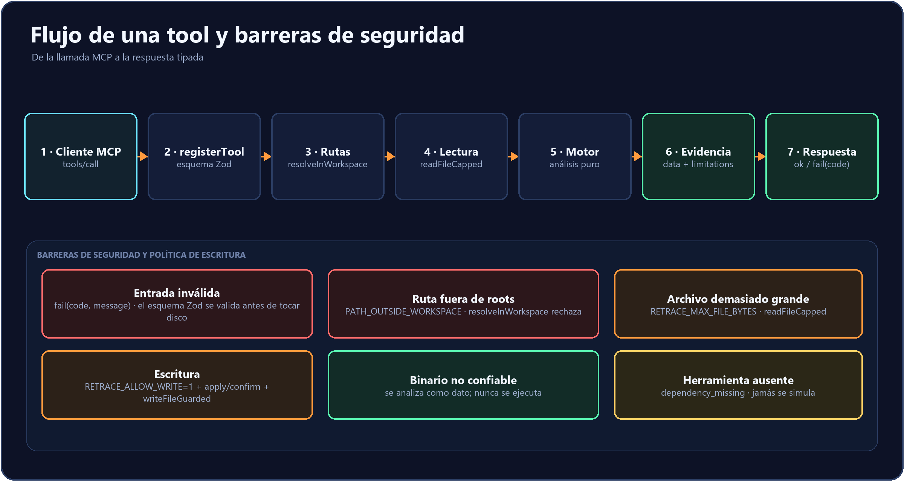

<div align="center">


# Retrace MCP

**Ingeniería inversa verificable de Nintendo 64 y PlayStation 2 dentro de tu agente de IA.**

[](CHANGELOG.md)
[](https://modelcontextprotocol.io)
[](package.json)
[](pyproject.toml)
[](tests)
[](LICENSE)

</div>

Retrace es un servidor **Model Context Protocol (MCP)** para analizar ROMs de
**Nintendo 64**, ejecutables **ELF de PlayStation 2** y binarios **MIPS**
(R4300i y R5900). Expone parsers, desensamblado, memoria, gráficos, audio,
comparación de funciones, un grafo de conocimiento y un pipeline de
portabilidad N64 → PS2. Cada respuesta incluye datos, evidencia y límites
explícitos: el agente puede investigar un binario sin inventar lo que no puede
probar.

> **Diseñado para evidencia, no para demos.** Si falta una dependencia, una tool
> devuelve `dependency_missing`. Si un formato no está implementado, devuelve
> `UNSUPPORTED`. Nunca se simula un resultado.

---

## Contenido

- [Estado](#estado)
- [Principios de diseño](#principios-de-diseño)
- [Arquitectura](#arquitectura)
- [Secuencia de una llamada](#secuencia-de-una-llamada)
- [Capacidades y herramientas](#capacidades-y-herramientas)
- [Flujo de portabilidad N64 a PS2](#flujo-de-portabilidad-n64-a-ps2)
- [Seguridad y límites](#seguridad-y-límites)
- [Instalación](#instalación)
- [Variables de entorno](#variables-de-entorno)
- [Conexión a clientes MCP](#conexión-a-clientes-mcp)
- [Uso](#uso)
- [Estructura del repositorio](#estructura-del-repositorio)
- [Documentación](#documentación)
- [Desarrollo y verificación](#desarrollo-y-verificación)
- [Licencia](#licencia)

---

## Estado

| Componente | Estado |
| --- | --- |
| Servidor MCP TypeScript (`src/index.ts`) | **Implementación de referencia** · 65 tools · transporte stdio · 66 tests vitest |
| Sidecar Python (`src/retrace_mcp`, `src/python/retrace_analysis`) | Capstone + pyelftools · 40 tests pytest |
| Skills de ingeniería (`skills/`) | 21 procedimientos especializados |
| Diagramas | Fuentes `.drawio` + PNG en [`docs/diagrams`](docs/diagrams) |
| Decisión de stack | TypeScript es la implementación principal ([ADR-005](docs/coordination/DECISIONS.md)); Python se conserva como sidecar de análisis |
| Diagnóstico | `npm run probe` y la tool `retrace_probe` |
| Runtimes | Node.js >= 20 y Python >= 3.10 |

---

## Principios de diseño

- **Evidencia antes que nombres.** Un símbolo, un string o una heurística no
  prueban comportamiento. Las respuestas incluyen `evidence` y `limitations`.
- **Solo lectura por defecto.** ROMs, ELFs y dumps se abren como datos; nunca se
  ejecuta código extraído de ellos.
- **Una implementación por capacidad.** El servidor TypeScript es la referencia;
  el sidecar Python aporta Capstone/pyelftools cuando corresponde.
- **Sin datos de juegos en el repositorio.** No hay ROMs, BIOS, ISOs ni assets.
  Los fixtures de test son sintéticos.
- **Fallar de forma explícita.** `ok: false` con un código de error verificable,
  nunca una respuesta inventada.

---

## Arquitectura

<div align="center">
  
</div>

<p align="center"><sub>Fuente editable: <a href="docs/diagrams/architecture.drawio">architecture.drawio</a></sub></p>

Capas principales:

| Capa | Ruta | Responsabilidad |
| --- | --- | --- |
| Transporte MCP | `src/index.ts` | Registro de tools y conexión stdio/JSON-RPC |
| Tools | `src/tools/**` | Validación Zod, permisos y respuestas `ok/fail` |
| Dominio | `src/parsers`, `src/mips`, `src/memory`, `src/graphics`, `src/audio`, `src/compare`, `src/port`, `src/knowledge`, `src/build` | Análisis puro, sin I/O de red |
| Infraestructura | `src/security/paths.ts`, `src/core/exec.ts`, `src/config.ts` | Rutas, ejecución sin shell y límites |
| Evidencia | `src/core/evidence.ts` | Formato uniforme de resultado |
| Sidecar | `src/retrace_mcp/**`, `src/python/**` | Capstone, pyelftools y análisis opcional |

Cada tool se registra con `registerTool`, valida su esquema con Zod y resuelve
rutas mediante `resolveInWorkspace`. Las lecturas pasan por `readFileCapped` y
las escrituras requieren `RETRACE_ALLOW_WRITE=1` más confirmación explícita.

---

## Secuencia de una llamada

<div align="center">
  
</div>

<p align="center"><sub>Fuente editable: <a href="docs/diagrams/sequence.drawio">sequence.drawio</a></sub></p>

El orden es deliberado: primero se valida el esquema, después la ruta, después el
tamaño. El motor de análisis no toca la red. El sidecar es opcional y, si no está
disponible, la respuesta lo declara en vez de degradar silenciosamente.

---

## Capacidades y herramientas

<div align="center">
  
</div>

<p align="center"><sub>Fuente editable: <a href="docs/diagrams/tool-map.drawio">tool-map.drawio</a></sub></p>

**65 tools MCP** agrupadas por subsistema:

| Subsistema | Herramientas | Nº |
| --- | --- | --- |
| Sistema | `retrace_probe`, `retrace_skill_list`, `retrace_skill_read`, `retrace_limits` | 4 |
| Repositorio | `repo_inspect`, `repo_get_architecture`, `repo_search_code`, `repo_find_references`, `repo_find_dependencies`, `repo_get_file_history` | 6 |
| N64 ROM | `rom_inspect`, `rom_identify_format`, `rom_find_code_regions`, `rom_compare` | 4 |
| ELF PS2 | `elf_inspect`, `elf_list_sections`, `elf_list_symbols`, `elf_find_function` | 4 |
| MIPS | `mips_disassemble`, `mips_analyze_function`, `mips_reconstruct_function` | 3 |
| Comparación N64/PS2 | `compare_functions`, `compare_rank`, `equivalence_record`, `equivalence_list` | 4 |
| Portabilidad | `port_project_plan`, `binary_translate`, `port_validate_translation` | 3 |
| Intake y toolchains | `project_intake`, `rom_validate`, `toolchain_probe` | 3 |
| Orquestación | `analyze_n64_rom`, `split_rom`, `ghidra_import`, `ghidra_analyze`, `decompile_function`, `recompile_rom`, `diff_function`, `generate_ps2_project`, `create_ps2_project`, `build_ps2`, `run_pcsx2`, `save_finding` | 12 |
| Memoria y crashes | `memory_inspect_region`, `memory_check_alignment`, `memory_analyze_overlap`, `crash_analyze` | 4 |
| Gráficos | `texture_inspect`, `texture_analyze_palette`, `texture_decode_n64`, `texture_decode_ps2` | 4 |
| Audio | `audio_inspect`, `audio_decode_vag_block`, `audio_decode_file` | 3 |
| Decomp config | `decomp_config_inspect`, `decomp_config_validate`, `decomp_config_propose_changes`, `decomp_config_apply_changes` | 4 |
| Knowledge Graph | `graph_node_upsert`, `graph_edge_upsert`, `graph_query_neighbors`, `graph_ingest` | 4 |
| Reportes y build | `generate_forensic_report`, `build_analyze`, `build_run` | 3 |

Cada tool devuelve un sobre uniforme:

```json
{
  "ok": true,
  "data": {},
  "evidence": [],
  "limitations": []
}
```

o, en caso de error:

```json
{
  "ok": false,
  "error": { "code": "dependency_missing", "message": "capstone is not installed" }
}
```

El catálogo detallado, parámetros y política de escritura viven en
[`docs/TOOLS.md`](docs/TOOLS.md). Los 21 procedimientos de ingeniería están en
[`docs/SKILLS.md`](docs/SKILLS.md) y se leen con `retrace_skill_list` /
`retrace_skill_read`.

---

## Flujo de portabilidad N64 a PS2

<div align="center">
  
</div>

<p align="center"><sub>Fuente editable: <a href="docs/diagrams/port-pipeline.drawio">port-pipeline.drawio</a></sub></p>

1. **Intake y validación** — `project_intake`, `rom_validate`, `toolchain_probe`,
   `retrace_probe`.
2. **Inspección binaria** — `rom_inspect`, `rom_identify_format`,
   `rom_find_code_regions`, `elf_inspect`, `elf_list_symbols`.
3. **Análisis y evidencia** — `mips_disassemble`, `mips_analyze_function`,
   `ghidra_import`, `graph_ingest`, `compare_functions`, `equivalence_record`.
4. **Traducción y proyecto** — `port_project_plan`, `binary_translate`,
   `generate_ps2_project`, `decomp_config_apply_changes`, `split_rom`.
5. **Build y validación** — `build_ps2`, `build_run`,
   `port_validate_translation`, `emulator-hardware-validation`,
   `generate_forensic_report`.

**Regla de oro:** `confirmed` solo se escribe con `equivalence_record` y
evidencia no vacía. La similitud estructural no es equivalencia semántica. Toda
escritura exige `RETRACE_ALLOW_WRITE=1` y confirmación explícita.

---

## Seguridad y límites

<div align="center">
  
</div>

<p align="center"><sub>Fuente editable: <a href="docs/diagrams/request-flow.drawio">request-flow.drawio</a></sub></p>

- **Path traversal:** toda ruta se resuelve contra los workspace roots; una ruta
  externa devuelve `PATH_OUTSIDE_WORKSPACE`.
- **Límite de lectura:** `RETRACE_MAX_FILE_BYTES` (512 MiB por defecto) y
  `RETRACE_MAX_SCAN_FILES` (20 000 por defecto).
- **Binarios no confiables:** se parsean como datos; nunca se ejecutan.
- **Herramientas externas:** se invocan como procesos conocidos, con argumentos
  validados, `shell: false` y timeout (`RETRACE_COMMAND_TIMEOUT_MS`).
- **Escrituras:** solo tools de escritura, con `RETRACE_ALLOW_WRITE=1`,
  `apply/confirm` y `writeFileGuarded`. Los archivos originales no se sobrescriben.
- **Sin simulación:** una dependencia ausente se informa como
  `dependency_missing`; un formato no soportado, como `UNSUPPORTED`.

---

## Instalación

### Requisitos

- **Node.js >= 20** y npm.
- **Python >= 3.10** con `capstone` y `pyelftools` para el sidecar de análisis.
- Opcionales: binutils MIPS, radare2, Ghidra, toolchain PS2, PCSX2. Se detectan
  en runtime y su ausencia no se simula.

### Servidor TypeScript (recomendado)

```bash
git clone https://github.com/anthoo582/retrace-mcp.git
cd retrace-mcp

npm ci
npm run build
npm run probe
```

`npm run probe` comprueba Node, workspace, límites y adaptadores externos.
Para arrancar el servidor:

```bash
node dist/index.js
```

### Sidecar Python

```bash
python -m venv .venv

# Windows (PowerShell)
.venv\Scripts\Activate.ps1

# Linux / macOS
source .venv/bin/activate

pip install -e ".[dev]"
python -m retrace_mcp --transport stdio
```

El sidecar aporta el desensamblador Capstone y el parser ELF con pyelftools. El
servidor TypeScript lo invoca cuando una tool MIPS o ELF lo necesita.

---

## Variables de entorno

| Variable | Default | Uso |
| --- | --- | --- |
| `RETRACE_WORKSPACE` / `RETRACE_ROOTS` | `cwd` | Roots permitidos, separados por `path.delimiter` (`;` en Windows, `:` en Unix) |
| `RETRACE_DATA_DIR` | `~/.retrace` | Grafo de conocimiento, equivalencias y hallazgos |
| `RETRACE_ALLOW_WRITE` | `0` | `1` o `true` habilita tools de escritura |
| `RETRACE_MAX_FILE_BYTES` | `536870912` | Tamaño máximo de archivo leído |
| `RETRACE_MAX_SCAN_FILES` | `20000` | Máximo de archivos al escanear un repo |
| `RETRACE_COMMAND_TIMEOUT_MS` | `60000` | Timeout de procesos externos |
| `RETRACE_PYTHON` | `python` | Intérprete para el sidecar |
| `RETRACE_HTTP_HOST` | `127.0.0.1` | Host HTTP opcional |
| `RETRACE_HTTP_PORT` | — | Activa transporte HTTP si está definido |
| `RETRACE_HTTP_PATH` | `/mcp` | Ruta HTTP del servidor MCP |

---

## Conexión a clientes MCP

Configuraciones listas en [`configs/`](configs/):

- **OpenCode** — [`configs/opencode.json`](configs/opencode.json). Copia el bloque
  `mcp.retrace` a tu `opencode.json`.
- **Claude Code** — [`configs/claude.mcp.json`](configs/claude.mcp.json). Renómbralo
  a `.mcp.json` en la raíz del proyecto o usa `claude mcp add`.
- **Codex** — [`configs/codex.config.toml`](configs/codex.config.toml). Fusiona el
  bloque `[mcp_servers.retrace]` en `~/.codex/config.toml`.

Ejemplo para OpenCode (ajusta las rutas absolutas):

```json
{
  "$schema": "https://opencode.ai/config.json",
  "mcp": {
    "retrace": {
      "type": "local",
      "command": ["node", "C:/ruta/a/retrace-mcp/dist/index.js"],
      "enabled": true,
      "environment": {
        "RETRACE_WORKSPACE": "C:/ruta/a/tu/proyecto",
        "RETRACE_PYTHON": "python"
      }
    }
  }
}
```

Guías paso a paso en [`docs/installation.md`](docs/installation.md).

---

## Uso

Con el servidor conectado, el agente dispone de las tools como funciones. Frases
típicas y tools que resuelven cada una:

| Pregunta del agente | Tools |
| --- | --- |
| "Inspecciona este ELF y lista sus símbolos." | `elf_inspect` + `elf_list_symbols` |
| "Identifica el formato de esta ROM N64." | `rom_identify_format` |
| "Desensambla la función en `0x80000400` como R4300i." | `mips_disassemble` |
| "Busca referencias a `main_func`." | `repo_find_references` |
| "¿Estas dos funciones son candidatas a equivalencia?" | `compare_functions` + `compare_rank` |
| "Prepara un port de N64 a PS2 y traduce estas palabras MIPS." | `port_project_plan` + `binary_translate` + `port_validate_translation` |
| "¿Qué tengo instalado y puedo empezar?" | `project_intake` + `rom_validate` + `toolchain_probe` |
| "Guarda este hallazgo en el grafo." | `graph_node_upsert` + `graph_edge_upsert` |
| "Genera un reporte forense del análisis." | `generate_forensic_report` |

Antes de una sesión de reversing conviene ejecutar `retrace_probe`: informa
versión, roots, política de escritura y adaptadores disponibles.

---

## Estructura del repositorio

```text
src/
  index.ts              # arranque MCP y registro de las 60 tools
  tools/                # validación y superficie MCP por subsistema
  parsers/              # N64 ROM, ELF, símbolos
  mips/                 # desensamblado, análisis y reconstrucción
  memory/               # regiones, alineación, overlap y crashes
  graphics/             # texturas N64 RDP y PS2 GS
  audio/                # VADPCM N64 y VAG PS2
  compare/              # comparación estructural N64/PS2
  port/                 # plan de portabilidad y traducción binaria
  knowledge/            # grafo de conocimiento e ingestión
  build/                # análisis y ejecución de builds
  reports/              # reportes forenses
  adapters/             # detección de herramientas externas
  core/                 # evidencia y ejecución sin shell
  security/             # resolución segura de rutas
  retrace_mcp/          # sidecar Python (servidor alternativo)
  python/retrace_analysis/  # motores Python: capstone, pyelftools
skills/                 # 21 skills de ingeniería
tests/                  # vitest (TypeScript) y pytest (Python)
docs/
  diagrams/             # fuentes .drawio + PNG generados
  assets/               # logo en pixel art
configs/                # ejemplos para OpenCode, Claude Code y Codex
scripts/                # probe y generador de diagramas
```

---

## Documentación

| Documento | Contenido |
| --- | --- |
| [`docs/ARCHITECTURE.md`](docs/ARCHITECTURE.md) | Capas, flujo de una tool y modelo de certeza |
| [`docs/TOOLS.md`](docs/TOOLS.md) | Catálogo de las 60 tools y política de escritura |
| [`docs/SKILLS.md`](docs/SKILLS.md) | Las 21 skills y su procedencia |
| [`docs/COMPARISON_ENGINE.md`](docs/COMPARISON_ENGINE.md) | Normalización, métricas y niveles de equivalencia |
| [`docs/KNOWLEDGE_GRAPH.md`](docs/KNOWLEDGE_GRAPH.md) | Nodos, aristas e ingestión |
| [`docs/INTEGRATIONS.md`](docs/INTEGRATIONS.md) | Herramientas externas y licencias |
| [`docs/AUDIT.md`](docs/AUDIT.md) | Auditoría del entorno |
| [`docs/ROADMAP.md`](docs/ROADMAP.md) | Próximos pasos y límites |
| [`docs/installation.md`](docs/installation.md) | Instalación por cliente |
| [`reports/Portabilidad N64 a PS2.md`](reports/Portabilidad%20N64%20a%20PS2.md) | Investigación y hoja de ruta del port |
| [`CHANGELOG.md`](CHANGELOG.md) | Historial de versiones |

Los diagramas son generados desde un único modelo:

```bash
pip install -e ".[graphics]"
python scripts/build_diagrams.py
```

Eso reescribe los PNG y los `.drawio` de [`docs/diagrams`](docs/diagrams). El
script requiere Pillow (extra `graphics`).

---

## Desarrollo y verificación

```bash
npm ci
npm run typecheck
npm test

python -m pytest tests -q
```

Estado esperado: **66 tests vitest** y **40 tests pytest** en verde.

Reglas del repositorio:

- `master` es la rama de integración. Trabaja en `work/<area>` y actualiza con
  rebase.
- Reclama una capacidad en [`coordination/STATUS.md`](coordination/STATUS.md)
  antes de implementarla.
- No se commitean ROMs, BIOS, ISOs, assets de juegos ni secretos.
- No se agrega una segunda implementación de una capacidad existente.

Protocolo completo en [`docs/coordination/PROTOCOL.md`](docs/coordination/PROTOCOL.md).

---

## Licencia

MIT. Consulta [`LICENSE`](LICENSE).

Retrace no distribuye ni incluye datos de juegos. Las herramientas externas
(binutils, radare2, Ghidra, toolchains, emuladores) se invocan como procesos
opcionales y conservan sus propias licencias; la procedencia se documenta en
[`docs/INTEGRATIONS.md`](docs/INTEGRATIONS.md).
