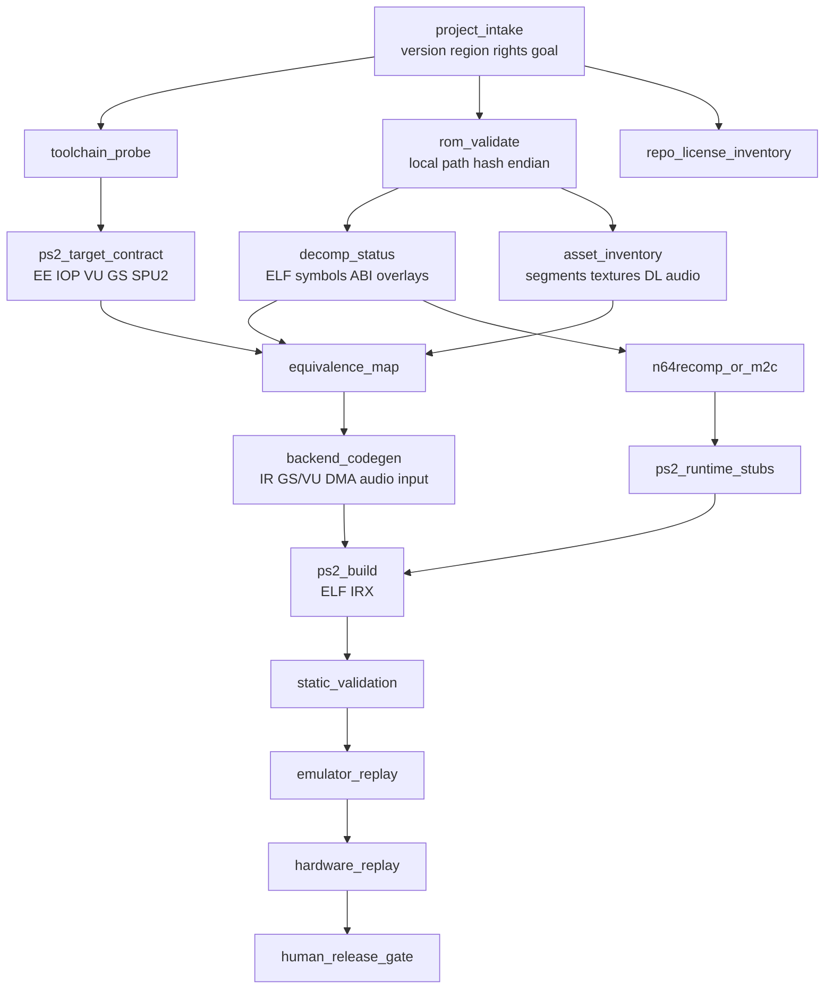

# Orquestar ports N64 a PS2 con evidencia

**Fecha de verificación: 2026-11-02.** Retrace MCP puede convertirse en un orquestador práctico para ports N64→PS2 si se define como un sistema local, reproducible y orientado a artefactos: valida entradas, descubre capacidades, ejecuta herramientas versionadas, construye backends PS2, compara resultados y detiene el flujo cuando falta una equivalencia demostrable. **No existe un conversor universal de ROM a port jugable**. N64Recomp genera C nativo a partir de un binario N64 y metadata, pero necesita un runtime; `splat` segmenta, `m2c` ayuda a comprender funciones y el toolchain PS2DEV produce ELF/IRX, pero ninguno traduce por sí solo RSP/RDP, audio, DMA, timing y periféricos a EE/IOP/VU/GS/SPU2. La arquitectura correcta es un DAG con contratos, manifests, trazas y gates humanos. Byte-swapping, similitud de assembly o un boot exitoso son evidencia parcial, no un port completo.

## La estrategia ganadora separa evidencia, port y distribución

El producto principal de Retrace no debe ser “un ELF generado”, sino un paquete auditable: inventario de entrada, mapa de segmentos y símbolos, capacidades de herramientas, equivalence map N64→PS2, código generado, stubs explícitos, presupuesto de memoria, trazas, golden files, SBOM/licencias y una lista de bloqueos. Cada tarea debe registrar `task_id`, hashes de entradas, versión/commit de la herramienta, comando, licencia, parámetros, salidas, diagnóstico y estado (`pass`, `blocked`, `dependency_missing`, `unsupported`, `needs_human`, `license_review_required`). El DAG se invalida si cambia el hash de una entrada, el toolchain o la configuración.

La ruta recomendada tiene dos carriles. El carril A usa `splat` para segmentar y describir el binario, y opcionalmente N64Recomp para obtener una recompilación estática que sirva como baseline funcional. El carril B usa `splat` + `m2c` + IDO/GCC pinneado para convertir funciones en C controlable y reemplazar progresivamente servicios, scheduler, gráficos, audio y entradas. Los carriles comparten metadata, tests y trazas, pero no deben confundirse: **recompilar código no equivale a portar el hardware** y hacer byte-match no equivale a conservar la semántica de renderizado o timing. ([N64Recomp](https://github.com/N64Recomp/N64Recomp), [splat](https://github.com/ethteck/splat), [m2c](https://github.com/matt-kempster/m2c), [IDO static recomp](https://github.com/decompals/ido-static-recomp))

Para homebrew, Retrace debe tomar PS2DEV/PS2SDK como camino por defecto: `ps2toolchain`, SDK, ports, gsKit, `ps2-packer` y `ps2client`. El build produce un ELF para EE y, cuando corresponde, módulos IRX para IOP; una ISO es un empaquetado posterior, no el artefacto mínimo de desarrollo. El contenedor o release debe fijarse por versión/digest, no por `latest`, y el probe debe comprobar compiladores EE, IOP y DVP, variables, rutas y binarios. Psy-Q/SDevTC sólo se admite como dependencia local aportada por un desarrollador licenciado; no debe descargarse, redistribuirse ni sustituirse silenciosamente por PS2SDK. ([PS2DEV](https://github.com/ps2dev/ps2dev), [PS2SDK](https://ps2dev.github.io/ps2sdk/index.html), [Psy-Q FAQ](https://psx.arthus.net/sdk/Psy-Q/DOCS/FAQ/psyq10.pdf))

## Herramientas integradas y nivel real de automatización

La integración debe ser local y mediante adaptadores pequeños. Cada adaptador envuelve una CLI o biblioteca, conserva stdout/stderr crudos y expone un envelope estable a Retrace; no se debe parsear únicamente texto humano cuando existe JSON, SQLite, protobuf o un archivo de símbolos estructurado.

| Herramienta/fuente primaria | Función en el port | Integración MCP propuesta | Licencia/dependencia | Automatización |
|---|---|---|---|---|
| [Nintendo 64 Programming Manual](https://ultra64.ca/files/documentation/nintendo/Nintendo_64_Programming_Manual_NU6-06-0030-001G_HQ.pdf) | Contrato de R4300, RSP, RDP, VI, AI, SI, DMA, IMEM/DMEM y TMEM | `n64_capability_reference`; genera reglas versionadas y límites, no ejecuta conversiones | Documentación; no redistribuir materiales no autorizados | Referencia/asistida |
| [Ghidra headless](https://github.com/NationalSecurityAgency/ghidra/blob/master/Ghidra/RuntimeScripts/support/analyzeHeadlessREADME.md) + [Emotion Engine Reloaded](https://github.com/chaoticgd/ghidra-emotionengine-reloaded) | Análisis de ELF, CFG, símbolos, MIPS y R5900/MMI | `ghidra_analyze`, `ghidra_export`; scripts y logs en workspace | Ghidra Apache 2.0 con terceros; extensión y JDK fijados | Automático con revisión |
| [Capstone](https://www.capstone-engine.org/arch.html) + [Ghidra-RSP](https://github.com/Random06457/Ghidra-RSP) | Decode MIPS/N64 y RSP | `mips_decode`, `rsp_decode`; corpus golden y endian explícito | Capstone BSD; módulo RSP separado | Automático para ISA cubierta |
| [radare2](https://github.com/radareorg/radare2) | Triage de ELF/Z64, análisis y JSON | `r2_inspect` con `iIj`, `aflj`, `pdfj`, `izzj`, `omij` y versión | LGPLv3 núcleo; plugins separados | Automático/asistido |
| [splat](https://github.com/ethteck/splat) | Segmentación de ROM/ELF y configuración YAML | `splat_create_config`, `splat_split`; sólo input local autorizado | Verificar LICENSE del commit instalado | Automático después de metadata |
| [N64Recomp](https://github.com/N64Recomp/N64Recomp) + [N64ModernRuntime](https://github.com/N64Recomp/N64ModernRuntime) | C generado y runtime de servicios/overlays | `n64recomp_generate`, `runtime_probe`; runtime PS2 propio pendiente | N64Recomp MIT; runtime GPLv3; revisar NOTICE | Asistido; no es backend PS2 |
| [m2c](https://github.com/matt-kempster/m2c) + [asm-differ](https://github.com/simonlindholm/asm-differ) | C aproximado y matching por función | `m2c_decompile`, `compare_function`; guardar contexto y diff | m2c GPL-3.0-only; asm-differ Unlicense; compiler/objdump | Asistido/manual |
| [BinExport/BinDiff](https://github.com/google/bindiff) | Matching entre binarios | `binexport_functions`, `bindiff_compare`; etapa opt-in | Apache 2.0 más disassembler/exporter | Asistido; Ghidra Tier 4 |
| [Diaphora](https://github.com/joxeankoret/diaphora) | Diff de funciones con SQLite | `diaphora_export`, `diaphora_diff`; sólo instalación autorizada | AGPL-3.0 y normalmente IDA/Radare2 | Manual/opt-in |
| [Z64Utils](https://git.mitgai.net/zeldaret/Z64Utils) | Filesystem, direcciones, display lists y texturas N64 | `n64_asset_inventory`, `displaylist_decode`, `texture_decode` | Revisar licencia del commit | Automático si formato conocido |
| [PS2DEV](https://github.com/ps2dev/ps2dev), [gsKit](https://github.com/ps2dev/gsKit) | Compiladores EE/IOP/DVP, SDK y acceso GS | `ps2dev_probe`, `ps2_build`, `elf_inspect` | PS2SDK Academic Free License 2.0; componentes separados | Automático una vez fijado |
| [PS2SDK loadfile](https://ps2dev.github.io/ps2sdk/group__loadfile.html) + [ps2client](https://github.com/ps2dev/ps2client) | Carga de ELF/IRX, logs y diagnóstico | `ps2_load_ee`, `ps2_load_iop`, `ps2client_listen`, `ps2_reg_dump` | Toolchain comunitario; hardware/red local | Asistido con allowlist |
| [PCSX2 debugger](https://pcsx2.net/docs/advanced/debugger/) | Emulación, símbolos R5900/R3000, VU y GS | `pcsx2_boot_elf`, `pcsx2_collect_logs`, `pcsx2_capture` | Emulador y BIOS aportados por usuario | Automático en CI si versión compatible |
| [n64decomp/sm64](https://github.com/n64decomp/sm64) + [sm64-port PS2](https://github.com/oitofelix/sm64-port) | Caso de prueba y precedente de build | `sm64_project_probe`, `sm64_asset_gate`, `ps2_target_build` | Licencias del proyecto y dependencias; ROM del usuario | Asistido, nunca distribución de ROM |

La selección base debe ser Capstone + radare2 para decode/triage, Ghidra headless para análisis profundo, splat para segmentación, N64Recomp para baseline, m2c/asm-differ para funciones, PS2DEV/PS2SDK/gsKit para build y PCSX2/ps2client para validación. BinDiff, Diaphora, IDO y Psy-Q quedan opt-in porque agregan dependencias o restricciones de licencia. Retrace debe generar un SBOM/NOTICE por ejecución: la licencia del orquestador no absorbe la licencia del runtime, renderer, SDK, compiler, exporter ni del juego.

## DAG de tareas y artefactos inmutables

El grafo recomendado es el siguiente; las ramas de inventario son paralelas y las etapas de equivalencia/build sólo avanzan cuando sus contratos están satisfechos.

`project_intake` produce `project.json` con juego, región, versión, objetivo, rutas locales y permisos declarados. `rom_validate` nunca copia la ROM: lee header, detecta `.z64/.v64/.n64`, calcula SHA-256/xxHash y conserva sólo metadata. `decomp_status` produce `symbols.json`, `relocations.json`, `abi-report.json`, `overlay-report.json` y una lista de MMIO/microcódigo no resueltos. `asset_inventory` produce `asset-manifest.json`, hashes y derivados autorizados: texturas, display-list IR, vértices, animaciones, bancos y secuencias.

`equivalence_map` es el contrato central: cada servicio N64 debe tener destino PS2, dueño de memoria, alineación, sincronización, tolerancia y estado. `backend_codegen` transforma una IR propia en paquetes GIF/GS, geometría VU1/EE, DMA/VIF, mixer SPU2/IOP, input y saves; registra cada pérdida o fallback. `ps2_build` produce ELF EE, IRX IOP, símbolos de debug, mapa de memoria, logs y hashes. `static_validation` comprueba secciones, entrypoint, relocaciones, alineación, tamaños, imports y ausencia de solapamientos antes de ejecutar.

Las salidas de validación son `timing-report.json`, `trace.ndjson`, `golden-index.json`, capturas framebuffer con resolución/color-space declarados, PCM de referencia, replays de input, snapshots de memoria y `capability-report.md`. El DAG no debe considerar “completo” un trabajo que sólo genera C, sólo compila o sólo arranca: el estado final exige pasar gates de equivalencia, estabilidad, licencia y hardware definidos para el objetivo.

## Tools MCP propuestos, entradas, salidas y gates

| Tool MCP | Entradas | Salidas | Gate de seguridad |
|---|---|---|---|
| `project_intake` | manifest del proyecto, versión/región, objetivo, rutas locales, declaración de derechos | `project.json`, `license-report.json` | No aceptar descarga de ROM/BIOS/ISO; pedir confirmación humana |
| `toolchain_probe` | rutas/imagen fijada | capacidades, versiones, commits, SBOM parcial | Si falta dependencia: `dependency_missing`; no fallback silencioso |
| `rom_validate` | ruta local, formato esperado opcional | hash, magic, endian, tamaño, CRC/región, diagnóstico | Read-only; rechazar ruta fuera de workspace autorizado y no persistir bytes |
| `decomp_status` | ELF/assembly/símbolos/YAML | funciones, ABI, relocaciones, overlays, instrucciones desconocidas | `UNSUPPORTED` si profile R4300/RSP/R5900 no está cubierto |
| `n64_asset_inventory` | metadata de formato, segmentos autorizados | manifest de assets y gaps | No exportar asset comercial; marcar formato desconocido |
| `run_splat` | YAML versionado + input local | segmentos, asm, linker metadata, logs | No ejecutar si config no referencia hash/versión conocida |
| `run_n64recomp` | TOML, ELF/binario, símbolos, relocations | C generado, stubs, hooks, reloc report | Etiquetar como `generated_code`, nunca como port jugable |
| `run_m2c` | función ASM, contexto, target compiler | C candidato, diagnóstico, score pendiente | Requiere revisión; no publicar ni enviar a servicio remoto |
| `compare_functions` | bins/objects, symbols, toolchain | match, CFG, diff, score, limitaciones | Informar que similitud no prueba semántica |
| `equivalence_map` | inventarios N64/PS2, decisiones | mapa RSP/RDP→VU/GS, AI→SPU2, SI→IOP, memoria/timing | Cada pérdida necesita aprobación o queda bloqueada |
| `ps2_build` | workspace allowlisted, Make/CMake fijado, target | ELF/IRX, map, symbols, logs, hash | Sólo comandos declarados; no shell arbitrario ni artefactos fuera del workspace |
| `ps2_artifacts_inspect` | ELF/IRX producido | secciones, entrypoint, relocaciones, imports, tamaños | Rechazar artefactos no producidos por el build validado |
| `pcsx2_boot_elf` | hash de ELF, perfil/version PCSX2, BIOS ya configurado | logs, captura, exit/timeout | No adquirir BIOS; timeout y sandbox; `UNSUPPORTED` si CLI no está verificada |
| `ps2client_listen` | host allowlisted, timeout | logs y métricas | No listener indefinido; cerrar si se pierde el enlace |
| `ps2_reg_dump` | sesión autorizada, registros read-only | dump DMAC/VIF/GIF/GS/VU/SIF | Bloquear `writemem`, `gsexec`, `startvu`, `stopvu`, `poweroff` por defecto |
| `replay_validate` | replay, golden framebuffer/PCM/trace | primera divergencia, métricas, diff | Tolerancias por escena aprobadas; no ocultar jitter/underrun |
| `release_gate` | todos los manifests y reportes | pass/block, lista de acciones | Revisión humana legal, hardware y distribución obligatoria |

Los errores deben ser explícitos: `invalid_rom`, `dependency_missing`, `UNSUPPORTED`, `license_review_required`, `manual_step_required`, `memory_budget_exceeded`, `timing_divergence` y `artifact_not_authorized`. No se deben producir pseudoparsers, microcódigo inventado, ISO falsa, ROM reconstruida ni “resultado exitoso” a partir de un decoder ausente.

## Qué se automatiza y qué no

Es automático: hash/endian/header; inventario de segmentos conocidos; decodificación de texturas CI/I/IA/RGBA y paletas; extracción de display lists conocidas a IR; decode de ADPCM/bancos con formato identificado; parseo de input estándar; manifests; SBOM; builds reproducibles; validación ELF/IRX; contratos de DMA/GIF; golden files; replay determinista y regresión de logs. La extracción conserva dimensiones, formato, palette, loops, sample rate, canales y hashes; si los bytes no pueden preservarse, se registra una métrica de pérdida.

Es asistido: clasificación de funciones y tipos; resolución de `gp`, relocaciones y overlays; elección de ABI y linker; traducción de scheduler/libultra; diseño de IR gráfica; selección de GS fijo, VU, múltiples passes o fallback software; mixer y streaming SPU2; asignación de memoria; tolerancias visuales/audio; tuning de frame pacing; reemplazo progresivo de stubs; y evaluación de escenas. El MCP propone cambios, compila y mide, pero un humano acepta la semántica.

Es manual: microcódigo RSP/RDP propietario, MMIO desconocido, efectos de framebuffer/coverage/AA sin equivalencia directa, bugs de timing que dependen de orden de DMA, ergonomía de input, saves/periféricos no estándar, artefactos ambiguos, revisión de licencias y decisión de distribución. `decomp.me` debe tratarse como herramienta interactiva por función: su propia FAQ desaconseja scraping, conexión de LLM y solicitudes repetitivas. ([decomp.me FAQ](https://www.decomp.me/faq))

Es unsafe o bloqueado: descargar ROM/BIOS/ISO, bypass de DRM/CIC, obtener claves, crackear discos, subir dumps, incluir assets comerciales, distribuir código/ROM derivado sin revisión, ejecutar ELF/IRX/ISO no verificado, escribir memoria arbitraria, operar `gsexec`/`writemem`/`poweroff` como comandos genéricos y presentar un byte-match como equivalencia total. La licencia del código no concede derechos sobre juego, marca, música, assets ni SDK propietario.

## Límites técnicos que gobiernan el port

**RSP/RDP→VU/GS.** N64 ejecuta tareas en RSP/RDP sobre microcódigo, IMEM/DMEM, TMEM, display lists, combiner, blender, coverage, framebuffer y Z-buffer; PS2 separa EE/IOP, VU0/VU1, VIF/DMA, GIF y GS. VU1 es un candidato natural para transformación/lighting/skin/partículas; el EE puede producir comandos; GIF/GS recibe estado y geometría; VIF/DMA impone ownership, alineación, caches y puntos de espera. El RDP no tiene sustitución 1:1: combiner/blender, TLUT, dither, antialiasing, coverage y efectos de framebuffer exigen mapeo por passes, código VU, software o una pérdida aprobada. Un display list F3D estándar puede decodificarse; microcódigo custom debe conservarse o reimplementarse caso por caso y puede quedar `UNSUPPORTED`. ([Nintendo 64 Programming Manual](https://ultra64.ca/files/documentation/nintendo/Nintendo_64_Programming_Manual_NU6-06-0030-001G_HQ.pdf), [PCSX2 debugger](https://pcsx2.net/docs/advanced/debugger/), [PS2SDK register definitions](https://ps2dev.github.io/ps2sdk/ps2__reg__defs_8h.html))

**Audio.** N64 separa Sound Player, Sequence Player, Synthesis Driver y microcódigo, con bancos `.ctl/.tbl/.sym`, ADPCM/PCM16, envelopes, pitch, pan, loops y scheduling. PS2 requiere decidir IOP/IRX para streaming y DMA, SPU2 para voces/mixer y, si hace falta, EE para preparación. Copiar samples no preserva mezcla, latencia, reverb ni orden de eventos; la prueba debe comparar PCM por tolerancia y eventos musicales/voice, detectar underrun y medir queue depth. ([Nintendo Audio Library](https://ultra64.ca/files/documentation/online-manuals/man-v5-2/allman52/pro-man/pro17/index.htm))

**ABI, relocaciones y overlays.** MIPS común no significa ABI común: R4300/N64, R5900/EE, MIPS16/64, delay slots, `$gp`, endianness, alignment, FPU/MMI y calling convention difieren. N64Recomp soporta overlays y relocaciones, pero su runtime debe resolver punteros y secciones; el ELF MIPS debe conservar `e_machine`, `e_flags`, `.mdebug/.symtab`, relocaciones y bases. PS2 ERL requiere enlace relocatable y `-G0` porque el loader no soporta relocación GP. Un match de funciones no resuelve un ABI ni un overlay. ([MIPS psABI/ELF](https://www.uclibc.org/docs/psABI-mips.pdf), [N64Recomp overlays](https://github.com/N64Recomp/N64Recomp#overlays), [PS2SDK ERL](https://github.com/ps2dev/ps2sdk/blob/master/ee/erl/README))

**DMA, memoria y timing.** RDRAM, DMEM/IMEM, TMEM, framebuffers y audio buffers no se asignan automáticamente a EE RAM, IOP RAM, VU memory, GS local memory o disco. El mapa debe declarar lifetime, tamaño, alineación, cache flush/invalidate, dueño y sincronización. El reloj debe representar VI/vsync, sample de input, audio quantum, DMA completion, interrupt y GS/VU fences. Se miden jitter, input-to-display, underrun, stalls, orden de DMA y frame pacing; un frame correcto no demuestra que el pipeline sea temporalmente equivalente. El checker debe fallar ante solapamiento o presupuesto excedido.

**Assets, periféricos y emulación.** Un filesystem conocido permite extraer texturas, geometría, animaciones, scripts y audio, pero no todos los juegos comparten layout. SI/PIF no es una lectura de botones: incluye inicialización del bus, Controller Pak, Rumble Pak, Transfer Pak, EEPROM, mouse y voz; cada dispositivo necesita adapter, replay y prueba de ausencia. PCSX2 sirve para boot, symbols, logs, capturas y regresiones, pero no sustituye PS2 real para latencia, stalls, audio, periféricos, video modes y bugs de hardware. ([Nintendo SI Devices](https://jrra.zone/n64/doc/pro-man/pro26/26-01.htm), [PCSX2 command line](https://wiki.pcsx2.net/index.php/Command-line_support))

## Hoja de ruta priorizada con aceptación y tests

| Fase | Prioridad y alcance | Criterio de aceptación | Tests obligatorios |
|---|---|---|---|
| 0. Contrato y seguridad | P0; manifests, workspace, allowlist, estados de error, exclusión ROM/BIOS/ISO | Toda tarea es reproducible, auditable y read-only por defecto | schema tests, path traversal, secret scan, licencia/SBOM, errores tipados |
| 1. Probe y evidencia | P0; `toolchain_probe`, `rom_validate`, `elf_inspect`, Ghidra/r2/Capstone | Diagnóstico honesto de endian, ABI, toolchain y dependencias | corpus de headers, golden disassembly R4300/RSP/R5900, ELF/IRX fixtures |
| 2. Segmentación y assets | P0; splat, Z64Utils, IR de display list/texturas/audio/input | Inventario con hashes, offsets, formatos y gaps; ninguna extracción desconocida se inventa | round-trip texturas, palettes, DL opcode coverage, ADPCM loops, input replay |
| 3. Recomp/decomp asistida | P1; N64Recomp baseline, m2c y asm-differ por función | C generado y matching quedan etiquetados; stubs y MMIO pendientes visibles | compile fixtures, relocation/overlay tests, CFG/reference diff, no claim de port |
| 4. Contrato PS2 mínimo | P1; PS2DEV/PS2SDK, ELF/IRX, linker, memory map, loadfile | Demo EE+IOP arranca, reporta logs y pasa checker de memoria/ABI | build reproducible, ELF sections/entrypoint, IRX load, reset/shutdown |
| 5. Backend gráfico | P1; IR→GS/GIF/VU1, texturas, depth/alpha, frame clock | Escenas sintéticas pasan golden aprobados y cada pérdida está catalogada | GS packet validity, VIF/DMA alignment, framebuffer pixel diff, timing/stall metrics |
| 6. Audio/input/saves | P1; SPU2/IOP, mixer, replays y adapters | SFX/música/input/save funcionan con colas y latencia dentro de tolerancia | PCM tolerance, no-underrun soak, buttons/analog/paks absent/present, reset |
| 7. Caso SM64 | P0 como benchmark; sólo build de usuario y assets autorizados | Menú, una escena 3D, cámara, input, SFX/música, pause/save, replay determinista | cold boot, scene golden, audio/input replay, PAL/NTSC, memory near limit, PCSX2 + PS2 |
| 8. Optimización y release | P2; VU/DMA tuning, ps2-packer opcional, empaquetado | Hardware gate, SBOM/NOTICE y revisión legal aprobados | soak, frame pacing, DMA stalls, IOP deadlock, clean shutdown, artifact provenance |

## Super Mario 64 como caso de prueba controlado

SM64 es el primer caso recomendado porque tiene decompilación pública, estructura de engine/headers/tools y un precedente de build PS2. El repositorio documenta que el usuario debe aportar su propia ROM para extraer assets; el port PS2 existente documenta PS2SDK/gsKit y genera un ELF. Retrace debe usar ese material únicamente como input local autorizado, no descargarlo, almacenarlo, subirlo ni incluir ROM, BIOS, ISO, texturas comerciales o binarios de juego en el repositorio o en el informe. ([n64decomp/sm64](https://github.com/n64decomp/sm64), [sm64-port building PS2](https://github.com/oitofelix/sm64-port))

El benchmark debe comenzar pequeño: una versión/región fijada por hash, menú y una escena determinista de Bob-omb Battlefield, un replay de input, una textura CI/RGBA, depth/alpha, un SFX, una secuencia musical, pause/resume y save/load. La primera aceptación no es “terminar el juego”: es que Retrace pueda producir `project.json`, `asset-manifest.json`, `memory-map.json`, `equivalence.md`, ELF/IRX, replay, framebuffer/PCM golden y `trace.ndjson`, y ubicar la primera divergencia entre N64 de referencia, emulador PS2 y hardware.

La comparación debe separar cuatro niveles. Nivel 1: el código/asset inventory es reproducible. Nivel 2: una función o asset tiene equivalencia documentada. Nivel 3: el backend PS2 reproduce una escena con tolerancia aprobada. Nivel 4: el juego mantiene input, audio, timing, memoria y estabilidad en hardware. Sólo el nivel 4 puede llamarse port jugable; el nivel 1 o un buen score de assembly no lo sustituye. El caso SM64 debe probar también que el MCP bloquea rutas no autorizadas, detecta ausencia de ROM/BIOS, devuelve `dependency_missing` y no crea una ISO ficticia.

## Conclusión

La mejor versión práctica de Retrace MCP es un **orquestador de evidencia y adaptación**, no un traductor mágico. Debe automatizar lo que tiene contratos observables —formatos, hashes, segmentación, decode, compilación, manifests, trazas y regresión— y convertir lo demás en decisiones explícitas con costes, pérdidas y gates. El backend PS2 debe crecer desde un contrato EE/IOP/GS/VU/SPU2 medible, no desde una promesa de compatibilidad binaria.

El primer objetivo técnico es una cadena local y reproducible `probe → validate → inventory → equivalence map → generate/build → static validation → replay → hardware gate`, validada con SM64 y sin distribuir material protegido. El resultado de cada etapa debe decir qué sabe, qué no sabe y qué requiere una persona. Esa honestidad —`UNSUPPORTED` cuando RSP/RDP, audio, ABI o timing no están resueltos— es la condición que convierte a Retrace en una herramienta de portabilidad utilizable y no en un generador de falsos positivos.
